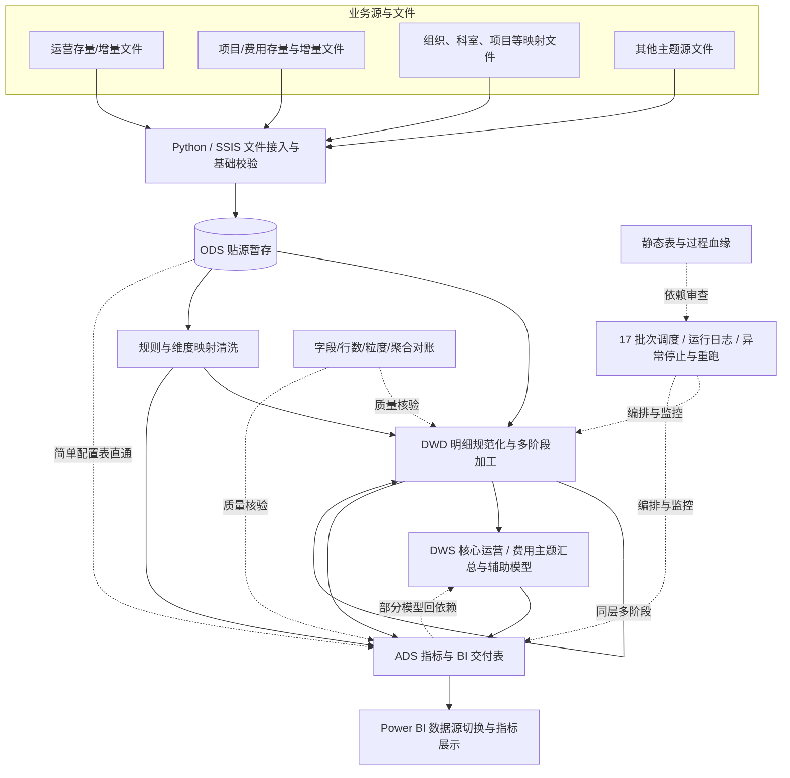

# 运营 BI 数据迁移与分层数仓加工链路重构

> **SQL Server / T-SQL · Python · SSIS · Data Warehouse · Data Quality · Lineage**  
> 一份基于实际实习经历整理的、**经匿名化改写的工程复盘**：重点记录如何把分散在 BI 侧的业务计算逻辑拆成可维护、可验证的数据加工链路，而不是展示保密业务数据。

> [!IMPORTANT]
> **匿名化声明**：企业以“某连锁服务机构”指代，内部表名与代号均已泛化（如 `OpsLine` / `BillingLine`），文中 SQL 均为重新编写的模拟代码。本仓库不包含原始 Excel、静态血缘 HTML、业务 SQL、生产截图或真实业务/患者记录；两套统计数字的口径说明见下表与 [docs/05](docs/05-questions-before-publishing.md)。

## 1. 项目概览

项目原本依赖 BI 层的部分 DAX 逻辑进行业务指标加工。随着业务主题、来源数据及规则逐渐增加，需要把核心计算过程下沉到 SQL Server 数仓：通过分层加工管理复杂逻辑，通过 ETL/存储过程完成批量处理，并用结果对账验证指标迁移的一致性。

我在实习中负责的重点不是简单“DAX 语法转 SQL”，而是：

1. **理解与拆解**：从预约、到访、费用流水、项目及组织映射出发，明确指标口径、业务筛选条件与数据粒度。
2. **分层重构**：依据 ODS / DWD / DWS / ADS 职责拆分源数据、清洗明细、主题汇总与应用交付。
3. **加工实现**：用 T-SQL 存储过程编排多阶段复杂关联、取值、聚合及窗口计算，并复核 DAX 与 SQL 的语义差异。
4. **链路交付**：用 Python / SSIS 接入业务文件；存储过程按 17 个依赖批次编排，失败时中止并记录日志，人工排障后重跑。
5. **质量闭环**：通过字段、行数、唯一性、分组汇总及 BI 换源对比，定位数据缺失、关联膨胀和口径差异。
6. **可维护性**：梳理表、过程、调度批次上下游关系，构建**静态**血缘追踪页面辅助排错与变更影响分析。

### 项目规模：分清统计口径

| 项目 | 数值或范围 | 口径及说明 |
|---|---:|---|
| 分层数据表 | 约 **199** 张 | 根据项目交付口径的累计覆盖数；不是同一时点的活跃表数；发布前复核 |
| T-SQL 存储过程 | **152** 个 | 项目累计开发口径；不等于血缘快照中的“当前过程数” |
| SSIS 包 | **41** 个 | 项目累计开发口径；工作簿中的“SSIS 包命名”清单不是全部实际包的终版证明 |
| 调度批次 | **17** 批 | 项目调度组织口径；血缘快照同样记录 `maxBatch=17` |
| BI 对接 ADS 表 | **118** 张 | 既有交付描述，发布前与最终 BI 换源清单复核 |
| 数据规模 | 整体千万级 | 跨层加工表可能存储同一业务事实，不应将各表行数相加为独立业务记录数 |
| 日常增量 / 月度全量加工 | 约 30 分钟 / 1 小时 | 既有运行描述；**未提供可复现 benchmark，不能宣称优化提升百分比** |
| 静态血缘快照（2026-09-21） | **192 表 / 145 当前过程 / 241 关系** | 独立快照口径；与累计交付数字不同，不应相互替代 |

> 快照补充：当日 **OpsLine 运营主题表约 326 万行 / 76 字段**，**BillingLine 项目主题表约 378 万行 / 105 字段**（以该 HTML 的 `ADS` 节点字段定义为准）。这是快照表结构和记录数，不代表业务唯一对象数或常态峰值。两张表都不是“实时分布式 PB 级数仓”。

## 2. 业务问题：为什么必须重构

目标分析场景覆盖组织/门店、预约与到访、费用项目、消费和运营绩效等多个主题。源数据的**同名字段未必同义**，同一业务对象也可能出现多条预约、项目或收款流水。

难点可以归结为四类：

- **指标口径混杂**：BI 的筛选上下文、最早/最近记录、历史累计与同日多次行为，不能直接等价于普通的 `GROUP BY`。
- **多粒度关联**：预约与项目、费用流水、映射规则可能一对多；未先确认关联键唯一性就 `LEFT JOIN`，会导致记录和金额放大。
- **源端数据质量不统一**：Excel 混合类型、合并单元格、日期序列号、金额精度、字段空白及全/半角差异都会改变结果。
- **长依赖链路难排障**：多主题表与存储过程存在阶段性依赖，任一上游口径或编排顺序问题都可能传播到多个下游指标。

项目因此不以“生成表”为唯一目标，而以**指标可解释、加工可核验、任务可恢复、依赖可追踪**为工程目标。

## 3. 总体架构

**重要：这是概念架构，不是所有数据表都依序走完四层。** 分层明细目录实际记录了 `ODS→DWD`（17 条）、`ODS→ADS` 简单配置直通（18 条）、`DWD→ADS` 直接消费（36 条）、DWD 同层多阶段加工（36 条）、ADS 静态配置表（19 条）及少数 `DWD/ADS→DWS` 历史路径（5 条），合计 131 条有效分类行（目录记录口径，非可运行任务数）。某些存在历史原因的跨层路径是**现状描述**，而非我推荐的一般数仓最佳实践。

## 4. 业务口径如何分解为数据模型

| 环节 | 我需要回答的问题 | 数仓中对应工作 |
|---|---|---|
| 业务定义 | 到访、预约、初复诊、收款、成交分别如何定义？ | 列出原 BI 指标表达式、时间窗口、筛选条件和边界样例 |
| 粒度确认 | 一行是一次预约、一笔收费、一个项目，还是聚合结果？ | 为各加工表编写“行级含义”，检查自然键、唯一性和一对多关系 |
| 规则映射 | 机构/科室/收费项目的标准化由谁决定？历史规则是否变过？ | 提前处理映射表重复、全半角、有效期和标准化字段 |
| 事实加工 | 多条收费记录如何计算金额？没有消费记录的预约是否保留？ | 区分明细与聚合；保留业务母集；避免关联膨胀及错误过滤 |
| 时间语义 | 最早/最近按什么时间？并列时按什么规则？ | 明确事件时间、排序字段、必要的稳定 tie-breaker |
| 指标交付 | 哪些维度需支持 BI 切片？ | ADS 的指标、字段类型、筛选口径与 Power BI 核对 |

为便于对照原工程梳理，两条业务加工主线在文中记作 **`OpsLine` / `BillingLine`**（原内部表代号已按公开边界泛化，下同）：

- **OpsLine：运营/预约主线**。关注预约行为、到访状态、规范组织与科室、历史记录等，最终为运营主题分析提供粒度一致的数据。
- **BillingLine：项目/费用主线**。关注费用项目、账单/流水、收费时间、项目分类及金额等；需要区别项目明细和付款明细，防止多笔支付放大业务对象。

两条主线都进行了多阶段处理。README 不罗列全部内部阶段编号；“为什么拆阶段”“每阶段保留什么粒度”详见 [建模与架构说明](docs/01-business-and-architecture.md)。在缺少生产存储过程源代码的情况下，文档不会捏造每一阶段的精确输入输出定义。

## 5. ETL 执行与数据质量闭环

调度设计以**上下游完成状态**决定后续是否执行；故障时记录任务、目标对象、时间和错误信息，并按当时的运行实践进行修复后重跑。需要说明的是：**不能把这写成完整的分布式事务或自动精确断点续跑**；项目既有做法主要是失败中止和人工排障后的链路重跑。

质量校验分为：

1. 源/目标记录数；
2. 关键字段缺失率及数据类型；
3. 自然键重复、`JOIN` 前后记录数/键唯一性；
4. 分组织、月份、业务类型的数量与金额核对；
5. Power BI 换源前后的最终指标一致性。

特别强调：**行数对得上，字段仍然可能变成 NULL；总金额对得上，部分分组仍可能错。** 因此不能仅用一个 `COUNT(*)` 宣布迁移成功。

## 6. 值得讲清楚的技术难题

Check List 中最值得复盘的六类问题：

| 主题 | 失败模式 | 关键认识 |
|---|---|---|
| Excel 混合数据类型 | 导入行数正常，部分列静默变 `NULL` | 入仓前要校验类型和值，不能只校验行数 |
| 多对多/一对多 `JOIN` | OpsLine/BillingLine 加工行数膨胀，临时表和 TempDB 压力增大 | 每次 JOIN 都要确认关联键、预期粒度和映射唯一性 |
| 历史维度误关联 | 历史预约被错误映射到医生的最新科室 | 历史事件必须匹配当时有效的维度版本 |
| 文本模糊匹配 | 以 `LIKE` 匹配多值预约项目，错误匹配科室 | 先拆分标准化，再做精确映射和有规则的取一 |
| 日期/金额精度 | 七位小数秒日期转换失败、金额与数量口径不一致 | 处理存储类型、精度、舍入规则和原 BI 语义 |
| 最近记录/初复诊 | 忽略 DAX 筛选上下文或把无消费的记录过滤掉 | 母集保留、时间排序、上下文翻译必须单独验证 |

见 [Check List 故障复盘](docs/02-checklist-postmortems.md)：每个问题尽量拆成**表现 → 业务影响 → 根因 → 修复/候选方案 → 复现测试 → 经验**，并注明已确认或待复核。

## 7. 结果、限制与学习

**可确认的交付方向**：数仓分层开发、SQL 加工、ETL 批次和质量核验完成了面向 BI 的数据交付准备，静态血缘文件形成了结构化的上下游追踪视图。

**我不会作出的无证据声明**：PB 级处理能力、Spark/Flink 生产环境、实时 CDC、自动化分钟级恢复、处理性能提升百分比、100% 零差异、未经确认的正式投产状态。

最重要的工程收获是：**复杂 SQL 的难点经常不是语法，而是先定义每一行代表什么、每个 JOIN 会不会改变粒度、业务指标是在什么时间和过滤上下文中计算的。**

## 8. 文档导航

- [业务架构、数仓分层和业务粒度](docs/01-business-and-architecture.md)
- [Check List：故障复盘与边界问题](docs/02-checklist-postmortems.md)
- [ETL、调度、血缘与运维](docs/03-etl-lineage-and-operations.md)
- [质量核验、验收口径与测试用例](docs/04-validation-and-acceptance.md)
- [待确认事实与发布前检查清单](docs/05-questions-before-publishing.md)
- [技术面试讲解与跨技术栈迁移](docs/06-interview-and-learning-notes.md)

## 9. 公开边界与复现说明

本仓库属于**项目工程复盘 / Architecture Case Study**，不是生产代码开源，也不是一个可一键部署的完整数仓系统。文档及 SQL 片段用于解释建模决策和验证方法，示例均基于**人工构造数据**，不含生产代码。

- 不包含真实患者资料、手机号、病历号、数据库账号、SQL Server 地址或内部任务日志。
- 不公开原始 Excel 检查清单和血缘 HTML；生产对象名需要替换为抽象别名。
- 如需公开截图，应使用模拟数据重建并检查表名、图层、节点属性、工具提示是否仍含敏感信息。
- 如需要对外披露具体项目数字和公司名称，请先确认组织的保密与授权边界。

## 10. 使用说明与后续维护

本仓库是**公开工程复盘**：README 讲项目总体脉络，`docs/01` 到 `docs/06` 分别讲建模、问题复盘、运维、质量、待确认问题和面试表达。发布前已按 `docs/05-questions-before-publishing.md` 完成公开边界检查；仍未确认的事实以该文档清单为准，**不把空白当作已完成**。文中 SQL 片段均为模拟示例，不能替代真实业务验收。

公开后如要扩展到 Spark/Hive，建议以另一个“个人学习项目”目录新增，不改写原实习生产技术栈。

## 11. 相关技术文档

- [Microsoft Learn：SSIS Excel Connection Manager（混合类型与 TypeGuessRows）](https://learn.microsoft.com/en-us/sql/integration-services/connection-manager/excel-connection-manager)
- [Microsoft Learn：SSIS 从 Excel 导入时的数据类型问题](https://learn.microsoft.com/en-us/sql/integration-services/load-data-to-from-excel-with-ssis)
- [Microsoft Learn：Power Query `Int64.From` 默认 `RoundingMode.ToEven`](https://learn.microsoft.com/en-us/powerquery-m/int64-from)

---

**作者注**：这些文档记录的是我从“把 BI 公式写成 SQL”到“按业务粒度设计和核验加工链路”的学习过程。对未复核的事实，我宁愿留白，也不把它写成看似完美的工程故事。
