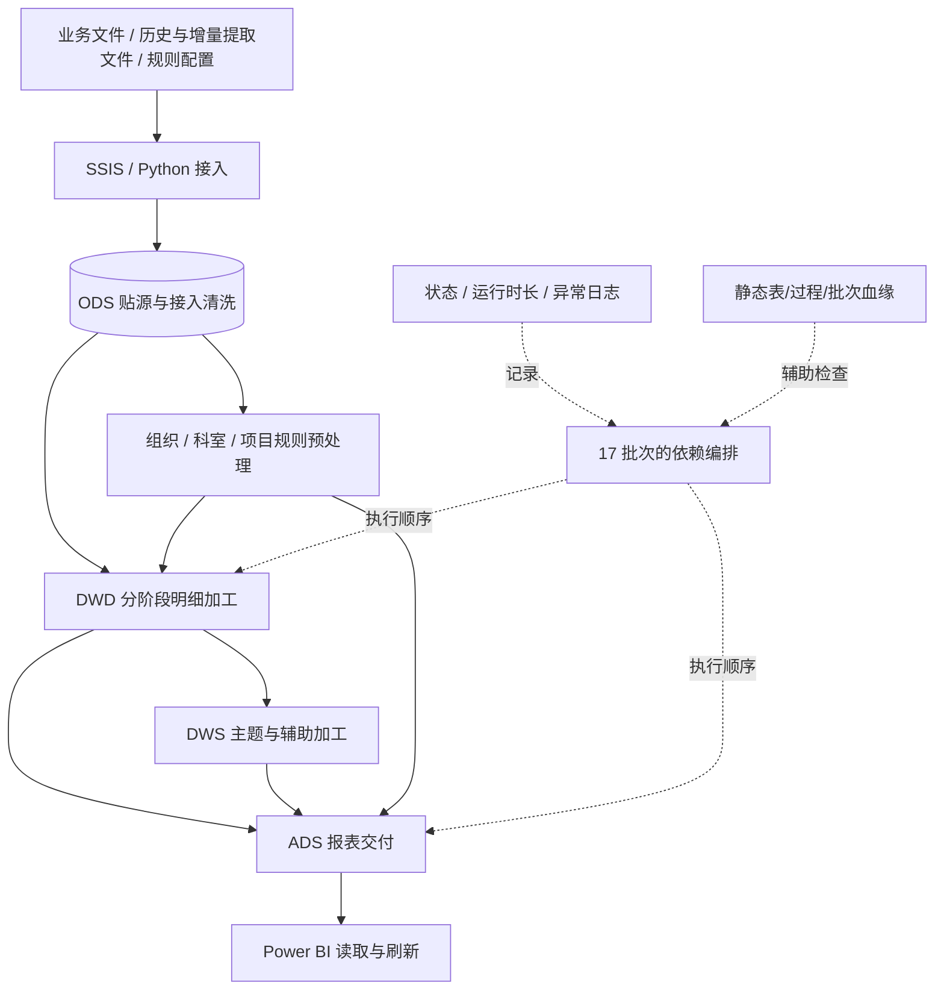

# 03｜ETL 接入、批次依赖、故障处理与静态血缘

> **依据与证据等级**：来源包括工作簿《运营 BI 数据迁移分层明细》的“SSIS包命名”“SQL SERVER 命名规范”“分层明细”“Check List”，以及 2026-09-21 静态血缘快照和项目复盘交流。**实际记录**与**推荐设计**分别标注；本页不包含生产连接串、原始表名或业务账户。

## 1. 任务的边界：数据接入与数据加工是两回事

项目中有两类不同的执行单元：

- **接入任务**：通过 SSIS Excel Source、OLE DB Destination 及 Python 脚本，把来自业务系统的文件、映射表和存量/增量数据导入数据库的贴源区域。工作簿“SSIS包命名”记录了 Excel 源组件、OLE DB 目标组件、包名与变量表达式样例。这是**接入层**工作。
- **SQL 加工任务**：存储过程在数仓内部根据源数据、历史映射和业务指标定义，执行标准化、明细计算、主题宽表生成和 ADS 产出。这是**转换与建模**工作。

两者均需要调度，却不应混淆为“每个存储过程对应一个 SSIS 包”。既有项目累计统计为 **41 个 SSIS 包、152 个开发存储过程、17 个调度批次**，三者是不同口径；当前资料没有提供一张可以逐项匹配这三组数量的最终发布清单。

### 概念级链路



> 特别提醒：`分层明细` 存在 ODS→ADS、同层加工以及 DWD/ADS→DWS 等非线性路径。示意图并不宣称所有表必经四层，也不能据此推断已经实现完整的 DAG 调度系统。

## 2. 文件接入的工程问题

### 2.1 Excel Source 的类型推断

工作簿 Check List 第 2 行记录了“总行数一致，字段却变 NULL”的案例。Excel 驱动在混合类型列中可能发生类型推断，导致不能兼容的值被解释为空。这是**读取数据时的静默失真**，与目标表 `INSERT` 行数正确并不矛盾。

记录的实际应对是：对问题表改用 Python 导入、补充字段清洗。更通用的验收流程是：

1. 文件级：文件数量、工作表名、源端行数、修改时间；
2. 列级：原始非空数、目标非空数、失败解析数；
3. 业务级：关键标识是否变空，日期与金额是否保真；
4. 异常级：无法解析的原始值保存到隔离明细（这是**后续改进建议**，不是已完成生产特性）。

### 2.2 合并单元格与日期序列号

Check List 第 3、13 行记录了合并区域后续行为空，以及 Excel 日期序列号被当作普通数字。Python 清洗可以帮助接入，但不能将所有空白单元格无条件向下填充：一段真实空值与某个合并区域的延展并不等价。日期序列号也需要以工作簿的日期系统为依据解释。

### 2.3 文件路径参数化

`SSIS包命名` 中可以看到类似 `@[User::varFilePath]` 的 Excel 连接字符串表达式，以及 `FRC_Loop_File` 等 Foreach 循环命名。结合项目实践，接入层曾处理文件夹遍历及动态连接路径；应确保**每轮循环不仅改变路径变量，也让 Excel Connection Manager 的 ConnectionString 表达式随变量重新计算**，否则会出现“循环多次，始终读首个文件”的风险。

**实际记录**：使用了参数化和 Foreach，曾解决源文件路径更新问题。**不能据此夸大为**自动感知任意新增数据源、实时文件监听和无需配置的弹性接入。

## 3. 17 批次为什么必须考虑依赖

在数据仓库中，某表或过程能否执行取决于它需要的上游是否完成。例如：某主题的 DWD 计算可能需要已加载的源事件、已规范化的映射表以及上一阶段的派生结果。只有运行时间顺序没有成功状态，仍可能读到旧数据或空中间表。

### 工作中的运行机制（既有交流）

- 将大量存储过程组织到 **17 个执行批次**；存在上下游批次顺序约束。
- 过程运行会记录状态、时间及异常；失败时中止后续任务。
- 故障处理包括定位异常过程、修复并重新运行；你此前描述的常见做法是**整条链路重跑**，不是成熟的节点级自动断点续跑。
- 项目中有定时刷新与人工维护/补跑场景；部分映射配置依赖人工维护。

### 真实可追溯的一次顺序调整

静态血缘 HTML 的 2026-09-21 更新备注中，记录了一个 ADS 过程从“早于必要 DWD 上游”的批次位置迁往后续批次的编排调整。此例可以用来说明：

- **排障观察**：下游读取结果异常，不能只检查本过程 SQL；
- **根因方向**：是否在上游生产完成前执行了消费步骤；
- **解决原则**：基于上下游依赖重排执行位置并回归检查；
- **可迁移能力**：DAG 依赖判断，与 SSIS、Airflow、DolphinScheduler 的语法无关。

> 血缘记录还提到“39 个过程的回滚机制修复”。这**不能等价于**已实现跨 152 个过程的全局事务、Exactly Once 或无人工参与的自动恢复。只有获取实际事务和调度日志后才能确认回滚边界。

## 4. 失败处理：明确已经做过什么、没做过什么

| 事件 | 既有工作流程 | 不能夸大的能力 |
|---|---|---|
| Excel 文件异常 | 通过清洗脚本或修复包配置重新接入 | 未证明任意 Excel 自动容错 |
| 某批次存储过程报错 | 错误日志定位任务；阻断后续任务 | 未证明独立任务自动容错和动态 DAG |
| 业务口径差异 | SQL 回溯上游、修改后进行 BI 对账 | 未证明指标 100% 零差异 |
| 中间层输出错误 | 排查后对链路执行重跑 | 未证明精确断点续跑或任意节点幂等 |
| 血缘依赖变更 | 更新静态依赖快照，辅助核查影响范围 | 不是自动实时血缘发现 |

### 故障恢复的建议验证清单（未来实践，不等于生产已实现）

- **幂等性**：同一业务周期的任务重跑两次，目标数据是否重复？
- **局部失败**：任务执行到一半时，临时表和目标表的状态如何？
- **数据完整性**：批次状态为成功，但产出为 0 行，是否被错误视为成功？
- **依赖一致性**：是否有跨批次遗漏或晚到数据进入已加工月份？
- **错误日志**：是否保存任务 ID、批次、输入范围、错误代码、受影响对象和恢复动作？

这些测试有助于日后把当前调度经验迁移到 Airflow / DolphinScheduler 等平台。

## 5. 数据血缘：从“连线图”到排障工具

静态血缘 HTML 快照日期为 **2026-09-21**，显示 `192` 个数据表节点、`145` 个当前过程记录和 `241` 条上下游关系，最大批次 `17`。与累计开发的 `199` 表、`152` 过程不属于相同计数口径。

该 HTML 提供的交互包括对象搜索、不同业务域筛选、表的来源/去向、过程详情、批次位置与链路追踪。它是静态数据快照的交互展示，并非直接订阅数据库元数据或任务日志的动态解析系统。

### 对血缘元素的抽象结构

```text
Table { object_id, layer, domain, row_count_snapshot, batch }
Procedure { procedure_id, batch, sequence, target, source_tables[] }
Dependency { source_object_id, target_object_id, procedure_id }
```

上述为**公开复盘用的概念数据模型**，并不是对原 HTML 内部全部 JSON 属性的逐字复现。

### 血缘如何帮助排错

1. 从报表异常字段/ADS 表定位下游输出表；
2. 逆向查找直接生成该表的存储过程；
3. 找出过程中依赖的业务事件表、映射规则或中间结果；
4. 核对批次执行顺序与上游产出是否一致；
5. 在修复后重新检查受影响的消费对象。

### 静态血缘的已知限制

- 上游 SQL 被修改后，HTML 不一定自动同步更新；
- 不能根据静态图保证最新实际运行状态；
- 缺乏字段级表达式解析时，不宜宣称能够自动追踪每一个字段的计算来源；
- 没有真实依赖图校验的对象可能为“孤立节点”；孤立并不必然代表可以删除；
- 表/过程计数不能代替业务依赖影响的完整性验证。

## 6. 当前设计的改进方向（尚未在本项目落地）

1. **元数据采集**：对生产对象、存储过程引用和执行日志建立定期采集及版本记录；
2. **统一任务定义**：每个任务记录输入范围、输出对象、预期粒度、可重试条件；
3. **任务幂等**：按批次或业务日期实现可重复执行的加载策略；
4. **质量门禁**：在关键 DWD/DWS 阶段检查唯一性、空值率和金额汇总；
5. **血缘动态化**：通过解析 SQL 引用、读取调度配置和状态日志，逐步提高血缘更新频率；
6. **平台迁移**：未来可将任务 DAG 和检查点设计迁移到 DolphinScheduler/Airflow + Spark/Hive，但不能写成已有生产使用经验。

**这一部分的工程结论**：ETL 不止是把文件搬到数据库。一个可靠的数据加工链路，还需要明确何时运行、先运行谁、如何发现结果错误、发生故障后如何恢复，以及哪些下游会被影响。
